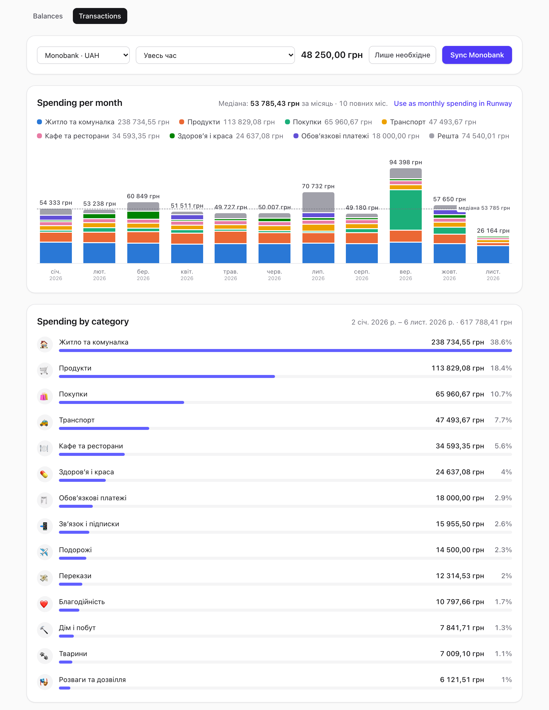
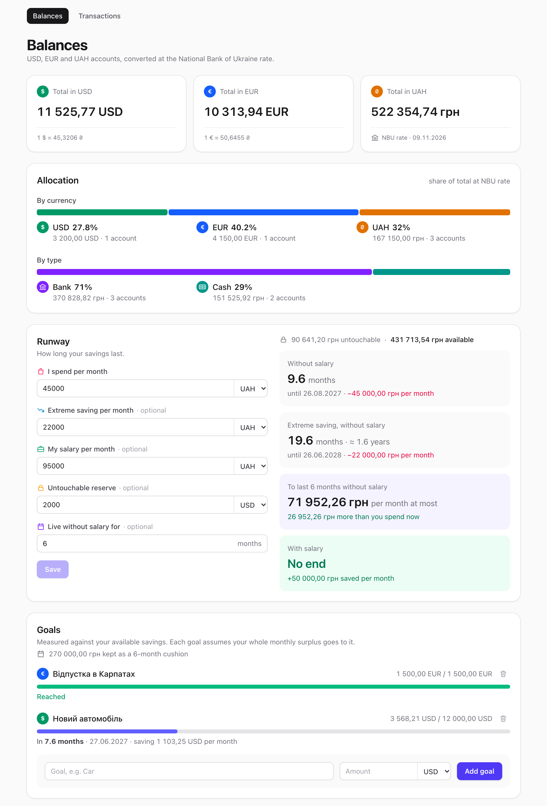
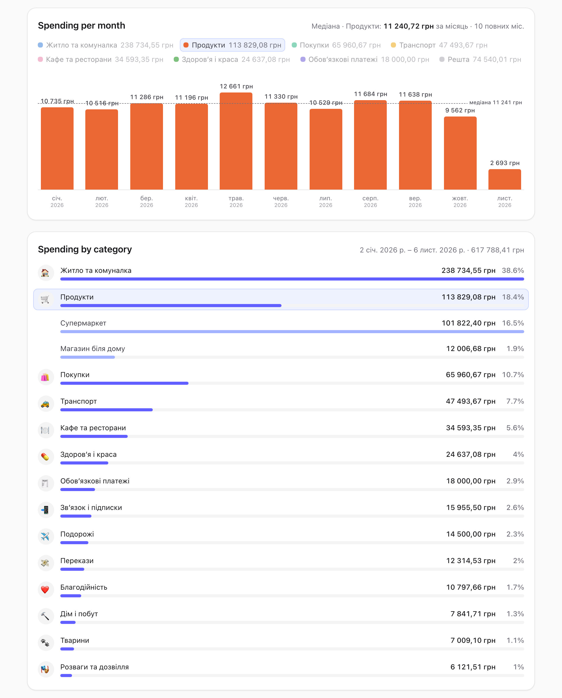
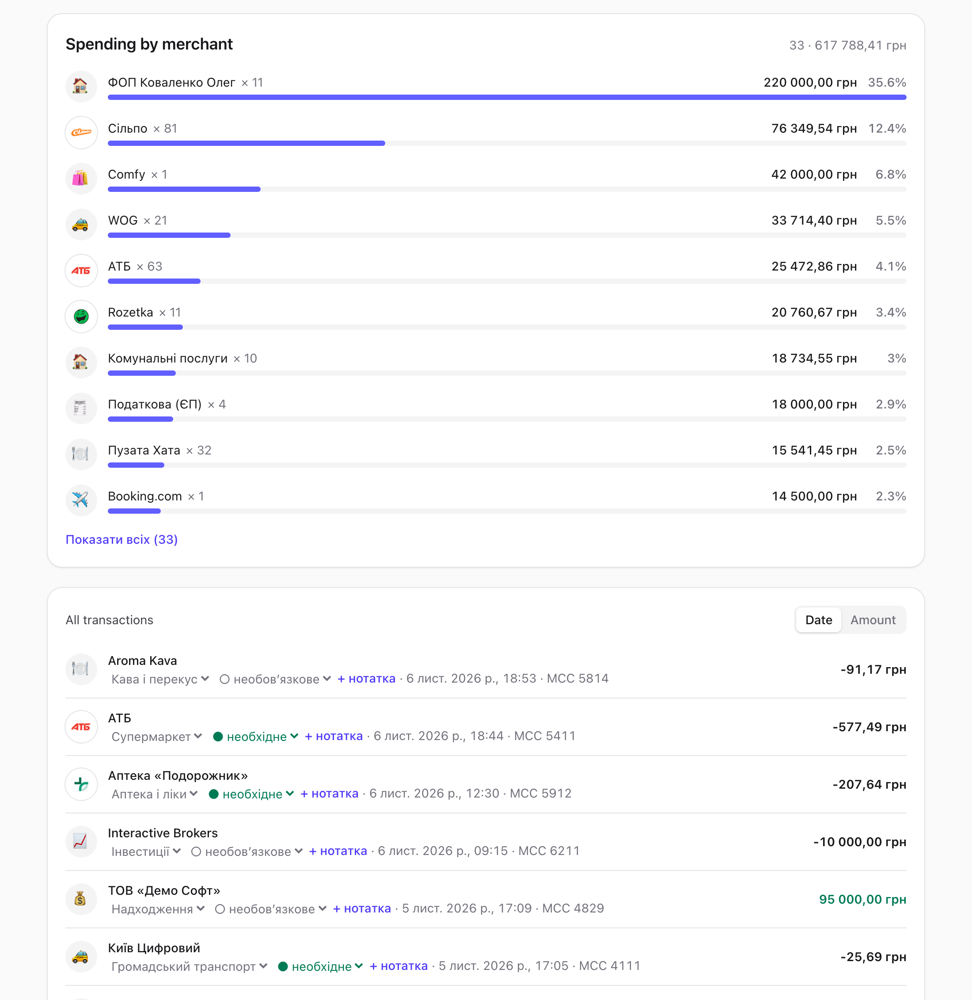
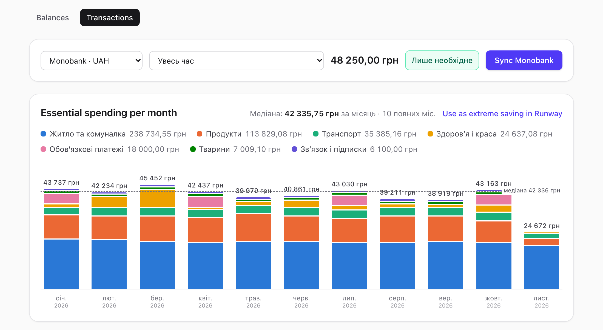

# Runway Budget

Personal balance tracker for USD, EUR and UAH accounts. Totals are converted at the official
[National Bank of Ukraine](https://bank.gov.ua) rate, and it estimates how long your savings last
and when you reach your goals.



<details>
<summary>More screenshots</summary>

| | |
| --- | --- |
|  |  |
|  |  |

</details>

Screenshots use made-up data from the demo seed (see [Demo data](#demo-data)).

## Features

- **Accounts**: add cash or bank accounts in USD, EUR or UAH, update their balances, rename, reorder or delete them.
- **Totals**: all balances summed in each currency at the NBU rate of the day.
- **Runway**: enter monthly spending, optional named incomes (a salary, a side job, rent, each in its own
  currency, marked if it keeps coming when the others stop, like a pension), an optional extreme-saving
  budget and an optional untouchable reserve, and see how many months your savings last with and without income. Enter how many months you want to live
  without income to see the most you can spend per month.
- **Cash flow**: income (`Надходження`), spending and savings rate over the last 12 complete
  months across all accounts, with a per-month table. The median income can be sent to Runway as an
  `Average income` entry (sending it again updates that entry), so runway and goal dates use what you actually earn.
- **This month against the usual**: each category's spending from the 1st to today next to the median
  of the same days in the last 12 complete months, with the change in percent («Продукти +34%»).
  Same days rather than whole months, so a half-gone month does not look cheap.
- **Recurring payments**: rent, subscriptions and regular donations, found as a merchant charged about
  once a month for a similar amount in at least 3 of the last 6 months and within the last 40 days,
  with the latest charge, the expected next date and the committed monthly total.
- **Goals**: set a target amount and see progress and the date you reach it at your current monthly
  surplus (income minus spending). Months you want to live without income are kept aside as a cushion
  and not counted toward goals.
- **Monobank sync**: pull the last month of one Monobank card's transactions and set the account
  balance from them, on demand and automatically at 09:00 and 21:00.
- **Transactions page**:
  - a stacked chart of spending per month by category, with a median line over complete months;
    picking a category or merchant reduces the bars to it to show its trend, and a year or quarter
    filter shows only its months (a picked month shows its year);
  - spending by category with a drill-down into subcategories;
  - spending by merchant;
  - filters by month, quarter, year or ISO week, category and merchant, all clickable from the charts;
  - sorting by date or amount and a note on any transaction.
  - opens on the latest year with transactions; «Увесь час» in the period filter shows everything.
- **Phones**: a bottom tab bar, compact balance cards and account rows, and a Transactions page that
  opens on the latest quarter, with the monthly chart showing that quarter.
- **Categories**: transactions are sorted into categories and subcategories automatically from their
  MCC. Correct one transaction or every transaction from a merchant, and mark transfers as income,
  moves between your own accounts or investments so they do not count as spending.
- **Minimal month**: spending is essential (rent, groceries, medicine, …) or optional. The
  «Усі витрати | Необхідні» switch shows only essential spending. The chart's monthly median can be sent to Runway: the full median as
  monthly spending, the essential one as the extreme-saving amount.

## Stack

pnpm workspace with two apps and a shared types package:

| Path   | What                                                                       |
| ------ | -------------------------------------------------------------------------- |
| `api/` | [Fastify](https://fastify.dev) + TypeScript, SQLite via [Drizzle ORM](https://orm.drizzle.team) and `better-sqlite3` |
| `web/` | React + TypeScript + [Vite](https://vite.dev), styled with [Tailwind CSS](https://tailwindcss.com) |
| `shared/` | `@runway-budget/shared`: TypeScript types for the API's JSON responses |

## Getting started

Requires Node.js 24 and pnpm.

```sh
pnpm install
pnpm dev
```

`pnpm dev` starts the API on <http://localhost:3000> and the web app on <http://localhost:5173>.
The API's routes live under `/api`, and the web dev server proxies `/api/*` to it. The SQLite database `api/data.db` is created and
migrated on first start; set `DB_FILE` to use another path.

## Demo data

`api/scripts/seed-demo.mjs` builds a separate database with made-up accounts, a budget, goals and a
year of Monobank-style transactions (public shop names; people, landlord and employer are invented).
It refuses to overwrite an existing file, so it never touches `api/data.db`. To run the app on it
next to your own:

```sh
pnpm --filter api demo:seed /tmp/demo.db
(cd /tmp && DB_FILE=/tmp/demo.db "$OLDPWD/api/node_modules/.bin/fastify" start -p 3124 "$OLDPWD/api/dist/app.js")
API_URL=http://localhost:3124 pnpm --filter web exec vite --port 5174
```

The API is started outside `api/` so it does not load your Monobank token from `api/.env`; build the
API first (`pnpm build`) so `api/dist` exists. `API_URL` points the web dev server's `/api` proxy at
any API (default `http://localhost:3000`).

## Docker

```sh
docker compose up -d --build
```

Serves the app on <http://localhost:8080> from a single container: the API serves the built web app
at `/` and its own routes under `/api`. The SQLite database is kept in the `data` volume.
`api/.env` is passed to the API container when it exists. The API container runs in
`TZ=Europe/Kyiv` so the Monobank sync happens at local 09:00 and 21:00; change `TZ` in
`compose.yaml` for another time zone.

## Monobank

Create a personal token at <https://api.monobank.ua> and put it in `api/.env` (git-ignored, loaded
by the API on start):

```sh
MONO_TOKEN=...
MONO_ACCOUNT=...   # card account id from /personal/client-info
```

With these set, the API syncs on its own at 09:00 and 21:00 local time; press **Sync Monobank** on
the Transactions page to sync right away. Each sync fetches the last 31 days. To fill in older
history, call the sync endpoint once per earlier 31-day window, a minute apart (Monobank's rate
limit):

```sh
curl -X POST "localhost:3000/api/accounts/mono/sync?to=$(date -v-31d +%s)"
```

Re-syncing a window you already have adds nothing new but fills in each stored transaction's
`operationAmount` and `currencyCode`, which pair foreign-currency cancellations with their purchases.

## Scripts

Run from the repository root:

| Command      | What                                  |
| ------------ | ------------------------------------- |
| `pnpm dev`   | Start API and web in watch mode       |
| `pnpm build` | Build both apps                       |
| `pnpm test`  | Type-check and run API tests (in-memory SQLite); does not touch `dist` |
| `pnpm lint`  | Lint the web app with oxlint          |
| `pnpm --filter api demo:seed <file>` | Create a demo database (see [Demo data](#demo-data)) |

To work on one app: `pnpm --filter api dev` or `pnpm --filter web dev`.

## Database

The schema lives in `api/src/db/schema.ts`. After changing it, generate a migration:

```sh
pnpm --filter api db:generate
```

Migrations in `api/drizzle/` are applied automatically when the API starts. Money is stored in
integer minor units (cents/kopiykas).

## API

| Method   | Path            | What                                                  |
| -------- | --------------- | ----------------------------------------------------- |
| `GET`    | `/accounts`     | List accounts                                         |
| `GET`    | `/accounts/:id/transactions` | Transactions, newest first, with `merchant`, `category`, `categorySource`, `essential`, `essentialSource`, `mccDescription`, `merchantDomain`, `note` and `cancelled` |
| `GET`    | `/categories`   | Category tree `{ id, label, emoji, spending, subcategories: [{ id, label, essential }] }` |
| `PUT`    | `/categories/merchants` | Set a merchant's category `{ description, category }`; `category: null` resets it |
| `PUT`    | `/categories/transactions/:id` | Set one transaction's category `{ category }`; `null` resets it |
| `PATCH`  | `/transactions/:id` | Set a transaction's `{ note?, essential? }`; empty note or `null` clears |
| `PUT`    | `/categories/merchants/essential` | Mark a merchant essential `{ description, essential }`; `null` resets it |
| `POST`   | `/accounts/mono/sync` | Import 31 days from Monobank ending at `?to=` (unix seconds, default now) |
| `POST`   | `/accounts`     | Create account `{ name, currency, balance, kind? }` (`bank` default or `cash`) |
| `PUT`    | `/accounts/order` | Reorder: `{ ids }` with every account id in order |
| `PATCH`  | `/accounts/:id` | Update any of `name`, `currency`, `balance`, `kind` |
| `DELETE` | `/accounts/:id` | Delete account                                        |
| `GET`    | `/budget`       | Monthly spend, incomes and reserve, or `null`         |
| `PUT`    | `/budget`       | Set `{ monthlySpend, currency, incomes?: [{ name, amount, currency }], reserve?, reserveCurrency?, minimalSpend?, minimalSpendCurrency?, targetMonths? }` |
| `GET`    | `/goals`        | List goals                                            |
| `POST`   | `/goals`        | Create goal `{ name, target, currency }`              |
| `DELETE` | `/goals/:id`    | Delete goal                                           |
| `GET`    | `/rates`        | NBU rates as UAH per unit, cached for an hour         |

## How estimates work

- **Available savings** = total balance − untouchable reserve, converted at NBU rates.
- **Runway** = available savings ÷ monthly loss (spending, or spending − all incomes). A month is 30.44 days.
- **Savings rate** = (income − spending) ÷ income, summed over the shown months rather than a median
  of monthly rates, so one month of tiny income cannot skew it. Moves between your own accounts and
  investments count as neither income nor spending.
- **Goal ETA** = (target − available savings) ÷ monthly surplus. Each goal is measured on its own,
  as if the whole surplus goes to it.

Estimates assume flat spending and income, and ignore interest and inflation.

## Technical decisions

- **Monobank account is linked by id.** The account stores `mono_account_id`, so every sync updates
  the same account instead of creating a new one. Its currency comes from `client-info` when it is
  first created.
- **Sync is idempotent.** Each transaction keeps Monobank's own `id` under a unique index, and
  inserts skip ones already stored, so syncing twice never duplicates anything.
- **Balance excludes the credit limit.** Monobank's balance includes the bank's money, so the balance
  is the latest transaction's balance minus `creditLimit` from `client-info`.
- **Transactions store the account-currency amount.** A foreign purchase is saved as what it cost
  in the card's currency (`amount`), not the original operation amount.
- **One request per sync window.** Monobank allows one call per minute per endpoint and up to
  31 days + 1 hour per statement. A sync fetches exactly that window; a too-early sync returns 429.
  Monobank also caps a statement at 500 items, so a busier month would be cut off; paging is not
  implemented.
- **Two-level categories instead of raw MCC.** `api/src/categories.ts` holds one tree: 16 spending
  categories with subcategories (Продукти › Супермаркет, …), plus service categories without
  subcategories: `Перекази` (spending), `Надходження`, `Між своїми рахунками` and `Інвестиції`
  (not spending). MCC
  ranges sit on subcategories; where they overlap, the first in table order wins. A transaction and
  every stored override always hold a leaf id (a subcategory, or a category without any), and the
  web groups leaves under their parent. Some subcategories (food delivery, electricity, loans) have
  no MCC of their own and only fill through overrides. The raw MCC is still shown as `mccDescription`, from the
  Ukrainian `fullDescription` in [Oleksios/Merchant-Category-Codes](https://github.com/Oleksios/Merchant-Category-Codes)
  (MIT, license in `api/src/data/mcc.LICENSE`).
- **Category is decided on read, in this order:** the transaction's own category, then your
  merchant override, then the jar rule (`Поповнення «…»` is `ЗСУ і фонди`), then the MCC table,
  else `Інше › Інші витрати`. A positive transfer becomes `Надходження` (income). Only your explicit choices are stored,
  so changing a rule relabels the rest of history.
- **Two levels of override.** `transactions.category` fixes a single purchase (a Bluetti from
  Rozetka) without moving the merchant. `merchant_categories` keys on the lowercased description with the
  `Скасування. ` prefix stripped, so one correction covers every purchase and refund from that
  merchant.
- **Spending is net of refunds.** The summaries sum each category's or merchant's amounts, so a
  refund lowers what it belongs to. `Надходження`, `Між своїми рахунками` and `Інвестиції` are not
  spending and stay out of every summary and chart.
- **A cancelled purchase counts as nothing.** Monobank sends no link between a `Скасування. X` and
  the purchase it reverses (no field in the statement refers to another item, and cancellations have
  no `receiptId`), so `api/src/cancellations.ts` pairs them on read: the closest earlier unpaired
  purchase from the same merchant for the exact opposite `operationAmount` in the same `currencyCode`.
  Not the account-currency `amount`, because each side of a foreign purchase is converted at its own
  day's rate. Both rows come back with `cancelled: true`; the charts, summaries and cash flow skip
  them, so a purchase on the 30th cancelled on the 2nd no longer moves spending between months, and
  the list shows them struck through. The balance chart keeps them, since the money did move. A
  partial refund has no exact pair and stays an ordinary refund. Rows synced before the operation
  columns pair on `amount` until a sync of their window fills them in (see [Monobank](#monobank)).
- **A merchant is its normalized description.** The API returns `merchant` (lowercased, `Скасування. `
  stripped), the same key merchant overrides use, so the merchant summary, filter and corrections
  agree. Different spellings of one shop (`MOLLI 1`, `Molli`) stay separate merchants.
- **Merchant icons come from a hand-kept keyword map.** Monobank sends no logos, only a description
  such as `Apple` or `Сільпо`. `api/src/data/merchants.json` maps a domain to name fragments, matched
  case-insensitively on read; the web app shows that domain's favicon from Google's favicon service
  (which therefore sees the shown domains). Unmatched merchants show their category's emoji. Add a
  line to the map to cover a new shop.
- **Transactions are deleted with their account** via an `ON DELETE CASCADE` foreign key.
- **Essential follows the category, with the same two override levels.** Each subcategory carries an
  `essential` default in `api/src/categories.ts` (housing, groceries, medicine, mobile and internet,
  public transport, fuel, mandatory payments, pets). A merchant flag (`merchant_essentials`) and a
  transaction flag (`transactions.essential`) win over it, independently of the category overrides.
  The minimal month is the median of essential spending over complete months.
- **Scheduled sync runs in the API process.** `api/src/plugins/mono-schedule.ts` sets a timer for the
  next 09:00 or 21:00 local, so it works the same under `pnpm dev` and Docker without a cron. Fixed
  times rather than "every 12 hours from start", because dev restarts the server on every change and
  Monobank allows one statement request per minute. Each run re-reads 31 days, so a run missed while
  the server was down loses nothing. The route and the schedule share `api/src/mono.ts`.
- **Summaries and filters run in the browser.** The page loads an account's whole transaction list
  and groups it by month, ISO week, category and merchant locally, so month and week boundaries use
  the viewer's time zone and switching filters needs no request. At ~1,500 transactions grouping
  takes well under a millisecond; what cost time was rendering. The list therefore shows 100 rows at
  a time («Показати ще» for more), and a row's category and essential flag are plain buttons that
  swap in their dropdown only when clicked. That took a year of transactions from 153k page
  elements (108k dropdown options) and ~1.4 s per filter change to 1.8k elements and ~40 ms.
- **Monthly chart folds small categories.** It colors the seven biggest categories over the shown
  range and folds the rest into one gray `Решта`, since more hues stop being distinguishable. The
  colors are CSS variables in `web/src/index.css`, checked for color-blind separation and contrast
  in light and dark mode. A selected category or merchant replaces the stack with that one series.
- **Median over complete months.** The chart's median leaves out the running month, which would
  pull it down, counts months without spending as zero when a category or merchant is selected, and
  covers only the months the period filter shows (every month for all time or a week).
  The median, not the average, so one big month barely moves it. Sending it to Runway goes through
  `web/src/lib/budget.ts`, which rebuilds the whole budget body because `PUT /budget` clears any
  field it is not given.
- **Shared package is types only.** `shared/index.d.ts` declares the response shapes (`Account`,
  `Transaction`, `Category`, `Budget`, `Goal`, `Rates`) and the `Currency`/`AccountKind` unions. The
  API types its response mappers with them and the web reads them, so a changed field fails to
  compile on both sides. Imports are type-only, so nothing is built or shipped: it is a dev
  dependency and the API image runs without it. Runtime lists (currencies, account kinds) stay in
  each app, checked with `AllOf<Union, typeof list>` so a missing or unknown member fails to compile.
- **Phone layout is the same components below Tailwind's `sm` breakpoint.** Layout differences are
  `sm:`/`max-sm:` classes; the two behaviors that need JavaScript (opening on the latest quarter,
  and the chart showing one quarter) read the same breakpoint from `web/src/lib/media.ts`. On a
  phone the chart's median still covers every complete month in the filter's scope, not only the
  quarter shown.
- **No router library.** The web app switches pages on `location.hash` (`#/`, `#/transactions`);
  a query after it carries page state, e.g. `#/transactions?account=3` opens that account.
- **Web layout:** `web/src/pages/` for the two pages, `components/` for their parts, `lib/` for
  types, API calls, formatting and shared class names.
- **Dev watcher ignores `data.db`.** `pnpm dev` restarts the API on file changes in `api/`; writes to
  the database are excluded so saving a category does not restart the server mid-request.

## TODO

- [x] Monobank sync: pull account balances from the [Monobank API](https://api.monobank.ua/docs/) with a personal token
- [x] Delete and rename accounts
- [x] Balance history over time
- [ ] Goals in priority order (reach one after another instead of each on its own)
- [x] Shared package for types used by both `api` and `web`
- [x] Income and savings rate from transactions (Cash flow card)

### Missing statistics

- [x] This month against the usual: each category's spending vs its median («Продукти +34%»)
- [x] Recurring payments: detect subscriptions (same merchant, similar amount each month) and show the
  committed monthly total
- [ ] Spread, not only the median: p25–p75 band or the worst month, since Runway assumes flat spending
- [ ] Year-over-year: same month last year and yearly totals per category
- [ ] Pace within the month: «spent X by the 14th, on track for Y»

### Missing financial concepts

- [ ] Historical NBU rates, so the balance chart and cash flow show currency gains and losses
- [ ] Inflation: real (inflation-adjusted) spending history and growing spending in runway and goal estimates
- [ ] Investments: track positions and value, count them in net worth, let goals assume a return
- [ ] Debts and loans: liabilities with interest, net worth as assets − liabilities
- [ ] Emergency fund target: N months of essential spending (3–6 is the usual rule) with a status
- [ ] Category budgets: a monthly cap per category and progress against it
- [ ] Taxes: set aside a ФОП's single tax and ЄСВ from income
